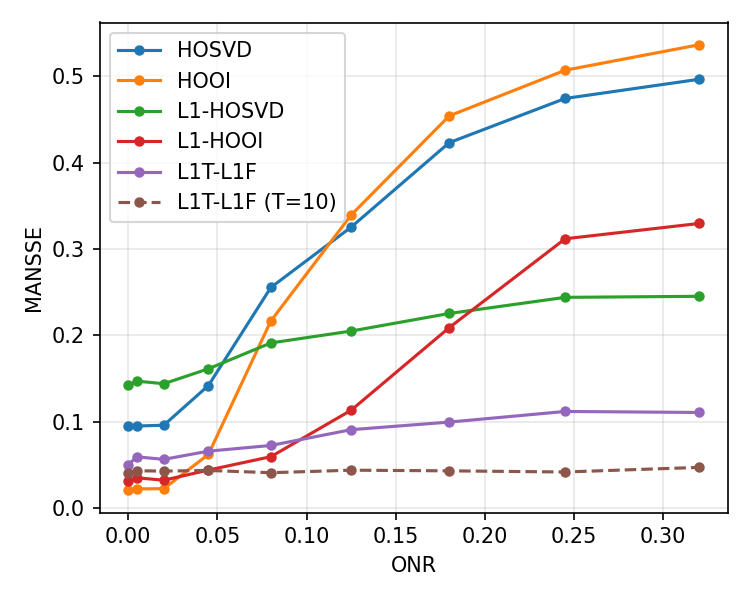

# Improved L1-Tucker via L1-Fitting

Python implementation of **L1T-L1F**, the outlier-resistant Tucker decomposition proposed in

> M. Mozaffari, P. P. Markopoulos and A. Prater-Bennette, "Improved L1-Tucker via L1-Fitting," *29th European Signal Processing Conference (EUSIPCO)*, 2021, pp. 1075-1079. [doi:10.23919/EUSIPCO54536.2021.9616014](https://doi.org/10.23919/EUSIPCO54536.2021.9616014)

Standard Tucker decomposition (HOSVD, HOOI) fits the data in the L2 norm and breaks down when a few entries are grossly corrupted. L1-norm Tucker (L1-Tucker) instead finds the orthonormal bases that maximize the L1 norm of the core, which makes it far more robust. L1T-L1F starts from the L1-HOSVD bases and, for each mode in turn, fits the data on the bases of the other modes in the L1 norm and recomputes the basis by L1-PCA of the fitted data. The L1 fitting step removes most of the influence of outliers, so the bases stay accurate even at corruption levels where the other methods degrade.

The package also implements L1-PCA, L1-HOSVD, L1-HOOI, HOSVD and HOOI, the metrics of the paper, and a script that reproduces its synthetic experiment. The original MATLAB code is kept in [`matlab/`](matlab).

## Installation

```bash
pip install git+https://github.com/Markopoulos-Research/Improved-L1-Tucker-via-L1-Fitting.git
```

or, from a clone, `pip install -e .`. The only dependencies are NumPy and SciPy (>= 1.7, for the HiGHS LP solver). Python >= 3.8.

## Quick start

```python
import numpy as np
from l1tucker import hooi, l1t_l1f, subspace_error
from l1tucker.synthetic import low_rank_tensor, sparse_outliers

dims, ranks = (5, 8, 5, 8, 5), (3, 3, 2, 2, 2)
rng = np.random.default_rng(0)
X, core, U_true = low_rank_tensor(dims, ranks, core_std=3.0, rng=rng)
X_corr = X + rng.standard_normal(dims) + sparse_outliers(dims, std=16, count=10, rng=rng)

res = l1t_l1f(X_corr, ranks)          # L1-HOSVD init + one L1-fitting sweep
print(subspace_error(U_true, res.factors))                    # L1T-L1F
print(subspace_error(U_true, hooi(X_corr, ranks).factors))    # standard HOOI

res.factors        # list of orthonormal bases U_n, shape (D_n, d_n)
res.core           # X x_1 U_1^T ... x_N U_N^T
res.reconstruct()  # low-rank approximation of X_corr
```

## API

| Function | Description |
|---|---|
| `l1t_l1f(X, ranks, T=1, init=None, ...)` | L1T-L1F (Algorithm 1 of the paper). `T` repeats the L1-fitting sweep; the paper also reports `T=10`. |
| `l1hooi(X, ranks, init=None, proj="L2", T=None, order=None, ...)` | L1-HOOI. `proj="L2"` is L1-HOOI with L2 projection; `proj="L1"` is the L1-fitting variant, i.e. L1T-L1F. `order` is increasing (default), `"random"` (new permutation every sweep) or a fixed permutation. |
| `l1hooi_random(X, ranks, init=None, proj="L2", T=None, ...)` | L1-HOOI variant that updates a single randomly chosen mode per iteration (never the same mode twice in a row); `T` counts single-mode updates. |
| `l1hosvd(X, ranks, init=None, ...)` | L1-HOSVD: L1-PCA of every mode unfolding. |
| `l1pca(A, init, ...)` | L1-PCA of a matrix by fixed-point iterations. |
| `l1_regression(W, x)` | `argmin_g ||W g - x||_1` by linear programming. |
| `hosvd(X, ranks)`, `hooi(X, ranks, init=None)` | Standard L2 Tucker baselines (sequentially truncated HOSVD, and HOOI as in Tensor Toolbox's `tucker_als`). |
| `subspace_error(U_true, U_hat)` | MANSSE, Eq. (13). |
| `reconstruction_error(X, X_hat)` | `||X - X_hat||_F^2 / ||X||_F^2`. |
| `l1tucker.synthetic` | Random orthonormal bases, Tucker tensors, sparse outliers and the ONR of Eq. (12). |

Every decomposition returns a `TuckerResult` with `factors`, `core`, `reconstruct()` and a `history` dict with the L1 metric after every basis update (plus subspace and reconstruction errors when `U_true` / `X_clean` are passed). `l1hooi` also returns `first_sweep`, the result after the first sweep, so one `T=10` run gives the `T=1` result as well. The L1 methods are initialized at L1-HOSVD, itself initialized at HOSVD, unless `init` is given.

## Reproducing Fig. 2

```bash
pip install matplotlib
python examples/synthetic_subspace.py --trials 100 --out results/fig2
```

A 5 x 8 x 5 x 8 x 5 tensor of ranks (3, 3, 2, 2, 2) with a N(0, 9) core is corrupted by N(0, 1) noise and 10 outliers drawn from N(0, sigma_o^2), sigma_o = 0, 2, ..., 16, and the mean MANSSE of each method is reported against the outlier-to-noise ratio (ONR).

Result with this implementation (100 trials per point, seed 0, about 15 minutes on 8 cores):

<p align="center"></p>

| ONR | HOSVD | HOOI | L1-HOSVD | L1-HOOI | L1T-L1F | L1T-L1F (T=10) |
|---:|---:|---:|---:|---:|---:|---:|
| 0.000 | 0.095 | **0.021** | 0.142 | 0.031 | 0.050 | 0.041 |
| 0.005 | 0.095 | **0.022** | 0.147 | 0.035 | 0.059 | 0.043 |
| 0.020 | 0.096 | **0.022** | 0.144 | 0.032 | 0.056 | 0.043 |
| 0.045 | 0.142 | 0.062 | 0.161 | 0.044 | 0.066 | **0.043** |
| 0.080 | 0.256 | 0.217 | 0.191 | 0.059 | 0.072 | **0.041** |
| 0.125 | 0.325 | 0.339 | 0.205 | 0.113 | 0.091 | **0.044** |
| 0.180 | 0.423 | 0.454 | 0.225 | 0.209 | 0.100 | **0.043** |
| 0.245 | 0.474 | 0.507 | 0.244 | 0.312 | 0.112 | **0.042** |
| 0.320 | 0.497 | 0.537 | 0.245 | 0.330 | 0.111 | **0.047** |

As in the paper, HOSVD and HOOI break down beyond an ONR of about 0.05, L1-HOSVD degrades slowly, and L1-HOOI lies in between. L1T-L1F with `T=10` stays almost flat and has the lowest error from ONR 0.045 on; a single sweep (`T=1`) already beats every other method from ONR 0.125 on. The absolute values depend on the fixed ground-truth core and bases: across 12 random instances, the error of plain HOSVD at ONR = 0 ranges from 0.05 to 0.13, and some instances match the curves of the paper closely.

## Implementation notes

- **L1 fitting.** Each row of the fitted core, Eq. (7), is an L1 regression. It is solved exactly as a linear program with SciPy's HiGHS solver, through the LP dual (`max x^T y` s.t. `W^T y = 0`, `|y| <= 1`), which is about 10 times faster than the primal for these tall problems. The run times in the paper were obtained with ADMM instead.
- **L1-PCA.** As in the original MATLAB code, L1-PCA is computed by the fixed-point iteration `B = sign(A^T Q)`, `Q = U V^T` with `A B = U S V^T`, started at the current basis, which increases `||A^T Q||_1` monotonically.
- **Conventions.** Unfoldings follow Kolda and Bader, the convention of the MATLAB Tensor Toolbox, so unfoldings and Kronecker products are ordered exactly as in the MATLAB code.
- **Differences from the MATLAB code.** The ground-truth arguments (`X_clean`, `U_true`) are truly optional (the MATLAB `L1HOOI` failed without them). For `proj="L1"`, `T` defaults to 10 as in MATLAB, but a larger `T` can be passed explicitly. L1-HOSVD defaults to `tol=1e-8`, `maxit=1000`, the settings of the paper's experiments. The Tensor Toolbox is no longer needed.

## MATLAB code

The original MATLAB implementation (`L1HOOI.m`, `L1HOSVD.m` and utilities) is in [`matlab/`](matlab). It requires the [Tensor Toolbox](https://www.tensortoolbox.org/). `L1HOOI(X, Ks, U0, 'proj', 'L1', 'T', 1)` is L1T-L1F, and `L1HOOI(X, Ks, U0)` is L1-HOOI with L2 projection.

## Citation

If you use this code, please cite

```bibtex
@inproceedings{mozaffari2021improved,
  title={Improved L1-Tucker via L1-Fitting},
  author={Mozaffari, Mahsa and Markopoulos, Panos P and Prater-Bennette, Ashley},
  booktitle={2021 29th European Signal Processing Conference (EUSIPCO)},
  pages={1075--1079},
  year={2021},
  organization={IEEE}
}
```
